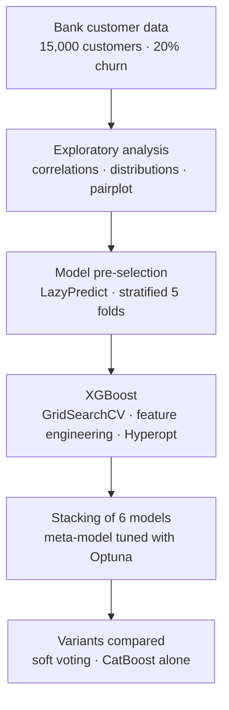

[Français](README.md) · **English** · [Tiếng Việt](README.vi.md)

# Bank customer churn prediction – Kaggle competition

Data Mining project of the MOSEF Master's programme (Statistical, Economic and Financial Modelling, M2), carried out in pairs, academic year 2024-2025. Course Kaggle competition: ranked 1st on the leaderboard.

Predict the probability that a customer leaves their bank (churn) from their profile and account activity. The competition scores the submitted probabilities with ROC AUC.

## Key results

ROC AUC in stratified 5-fold cross-validation (same folds for all models), on the 15,000 customers of the training set:

| Model | ROC AUC |
|---|---|
| Logistic regression | 0.891 |
| MLP | 0.929 |
| Random Forest | 0.932 |
| XGBoost | 0.936 |
| LightGBM | 0.936 |
| CatBoost | 0.938 |
| Soft voting of the 6 models (weights tuned with Optuna) | 0.937 |
| **Stacking of the 6 models (XGBoost meta-model tuned with Optuna)** | **0.939** |

- Stacking achieves the team's best Kaggle score (0.9371), close to its cross-validation score.
- CatBoost alone scores close in validation, but its Kaggle score dropped markedly: stacking was kept.

## Problem

About 20% of customers left the bank. ROC AUC measures how well customers are ranked by risk, independently of any decision threshold. Boosting models quickly reach a plateau (≈ 0.936): the challenge is to gain the last thousandths by combining models, without overfitting.

## Data

Competition dataset: `train.csv` (15,000 customers, target `Exited`, no missing values or duplicates) and `test.csv` (same structure, without the target).

| Variable | Description |
|---|---|
| `Surname` | Customer's surname |
| `CreditScore` | Credit score |
| `Geography` | Country: France, Germany, Spain |
| `Gender` | Gender |
| `Age` | Age |
| `Tenure` | Years as a customer |
| `Balance` | Account balance |
| `NumOfProducts` | Number of products held |
| `HasCrCard` | Has a credit card (0/1) |
| `IsActiveMember` | Active customer (0/1) |
| `EstimatedSalary` | Estimated salary |
| `Exited` | Target: 1 = the customer left the bank |

The identifiers `id` and `CustomerId` are not used as features.

## Approach

1. **Exploratory analysis**: correlations with the target (`Age` 0.45, `NumOfProducts` −0.31, `IsActiveMember` −0.20), distributions by class, pairplot. A profiling report is provided (HTML file).
2. **Model pre-selection** with LazyPredict (about thirty classifiers): boosting models (LightGBM, AdaBoost, XGBoost) come out on top. Preprocessing kept for the next steps: standardisation, one-hot encoding, and target encoding of `Surname`, fitted within each fold.
3. **XGBoost**:
   - GridSearchCV over 108 hyperparameter combinations (ROC AUC 0.937).
   - 14 new features tested one at a time; the gain stays below 0.001, 4 are kept (`AgeGroup`, `HasNoBalance`, `BalanceToSalaryRatio`, `AverageTenurePerProduct`).
   - Bayesian optimisation with Hyperopt (TPE, 200 trials): no significant gain.
   - Interpretation with SHAP.
4. **Stacking**: 6 base models (XGBoost, LightGBM, CatBoost, Random Forest, logistic regression, MLP), with preprocessing suited to each family (CatBoost handles `Surname` as a categorical feature). Their out-of-fold predictions feed a meta-model: logistic regression (GridSearchCV), then GradientBoosting and XGBoost tuned with Optuna.
5. **Variants**:
   - Soft voting of the 6 models, weights tuned with Optuna: weaker than stacking, with a wider train/validation gap (0.956 vs 0.937).
   - CatBoost alone: abandoned after its score fell on Kaggle.

## What the analysis shows

- `NumOfProducts`, `Age` and `IsActiveMember` carry most of the signal (SHAP), which confirms the exploratory analysis.
- Feature engineering and tuning add almost nothing beyond a well-configured XGBoost. The final gain comes from combining heterogeneous models.

## Limitations

- The gaps between the best models (0.936 to 0.939) are smaller than the fold-to-fold variation (0.935 to 0.945 for stacking): their ranking remains fragile.
- The meta-models' hyperparameters are chosen and evaluated on the same cross-validation: the stacking validation score is slightly optimistic.
- No decision threshold is defined: the competition only scores the ranking of probabilities. A retention use case would need a threshold set from the cost of a campaign.
- Target encoding of `Surname` improves the competition score, but this feature would be questionable in a production model.
- The notebook was built for Google Colab. Outputs come from several sessions and the environment is not frozen.

## Team

Project carried out in pairs: Minh Nhat Thy HUYNH, Sara LAVAL-JEANTET.

## Repository contents

| File | Content |
|---|---|
| `Sara_Thy_Projet_Data_Mining.ipynb` | Full notebook: exploration, pre-selection, XGBoost, stacking, voting, CatBoost |
| `Sara - Thy - Projet Data Mining.pdf` | Project presentation slides (December 2024, in French) |
| `Report of dataset - Sara - Thy - Projet Data Mining.html` | Profiling report of the training set (ydata-profiling); download it and open it in a browser |
| `requirements.txt` | Libraries and versions of the original environment |

## Running the notebook

1. The data come from the course Kaggle competition (M2 MOSEF); `train.csv` and `test.csv` are not included in this repository.
2. Open the notebook in Google Colab, then load both files through the upload dialog (`files.upload()`).
3. Cells marked « NE PAS LANCER » (do not run) are long (over 45 minutes, up to 1 h 30 for voting). Their results are kept in the outputs.

Original environment: Google Colab, Python 3.10. Library versions are listed in `requirements.txt`.
