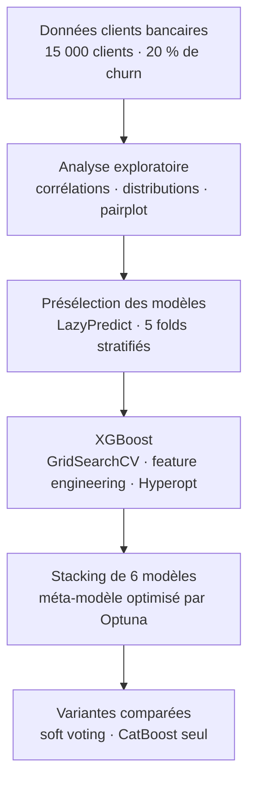

**Français** · [English](README.en.md) · [Tiếng Việt](README.vi.md)

# Prédiction du churn bancaire – compétition Kaggle

Projet de Data Mining du Master 2 MOSEF (Modélisations statistiques économiques et financières), réalisé en binôme, année 2024-2025. Compétition Kaggle du cours : 1re position au classement.

Prédire la probabilité qu'un client quitte sa banque (churn) à partir de ses caractéristiques et de l'activité de son compte. La compétition évalue les probabilités soumises par le ROC AUC.

## Résultats clés

ROC AUC en validation croisée stratifiée à 5 plis (mêmes plis pour tous les modèles), sur les 15 000 clients du jeu d'entraînement :

| Modèle | ROC AUC |
|---|---|
| Régression logistique | 0,891 |
| MLP | 0,929 |
| Random Forest | 0,932 |
| XGBoost | 0,936 |
| LightGBM | 0,936 |
| CatBoost | 0,938 |
| Soft voting des 6 modèles (poids optimisés par Optuna) | 0,937 |
| **Stacking des 6 modèles (méta-modèle XGBoost optimisé par Optuna)** | **0,939** |

- Le stacking obtient le meilleur score Kaggle de l'équipe (0,9371), proche de sa validation croisée.
- CatBoost seul atteint un score proche en validation, mais son score Kaggle a nettement baissé : le stacking a été retenu.

## Problématique

Environ 20 % des clients ont quitté la banque. Le ROC AUC mesure la capacité à classer les clients par risque, indépendamment d'un seuil de décision. Les modèles de boosting arrivent vite à un plateau (≈ 0,936) : l'enjeu est de gagner les derniers millièmes par la combinaison de modèles, sans surapprentissage.

## Données

Jeu de la compétition : `train.csv` (15 000 clients, cible `Exited`, sans valeur manquante ni doublon) et `test.csv` (même structure, sans la cible).

| Variable | Description |
|---|---|
| `Surname` | Nom de famille du client |
| `CreditScore` | Score de crédit |
| `Geography` | Pays : France, Allemagne, Espagne |
| `Gender` | Genre |
| `Age` | Âge |
| `Tenure` | Ancienneté du client (années) |
| `Balance` | Solde du compte |
| `NumOfProducts` | Nombre de produits détenus |
| `HasCrCard` | Possède une carte de crédit (0/1) |
| `IsActiveMember` | Client actif (0/1) |
| `EstimatedSalary` | Salaire estimé |
| `Exited` | Cible : 1 = le client a quitté la banque |

Les identifiants `id` et `CustomerId` ne sont pas utilisés comme variables.

## Démarche

1. **Analyse exploratoire** : corrélations avec la cible (`Age` 0,45, `NumOfProducts` −0,31, `IsActiveMember` −0,20), distributions par classe, pairplot. Un rapport de profilage est fourni (fichier HTML).
2. **Présélection des modèles** avec LazyPredict (une trentaine de classifieurs) : les modèles de boosting (LightGBM, AdaBoost, XGBoost) arrivent en tête. Prétraitement retenu pour la suite : standardisation, one-hot encoding, et target encoding de `Surname`, ajusté dans chaque pli.
3. **XGBoost** :
   - GridSearchCV sur 108 combinaisons d'hyperparamètres (ROC AUC 0,937).
   - 14 nouvelles variables testées une par une ; le gain reste inférieur à 0,001, 4 sont conservées (`AgeGroup`, `HasNoBalance`, `BalanceToSalaryRatio`, `AverageTenurePerProduct`).
   - Optimisation bayésienne avec Hyperopt (TPE, 200 essais) : pas de gain significatif.
   - Interprétation par SHAP.
4. **Stacking** : 6 modèles de base (XGBoost, LightGBM, CatBoost, Random Forest, régression logistique, MLP), avec un prétraitement adapté à chaque famille (CatBoost traite `Surname` comme variable catégorielle). Leurs prédictions out-of-fold alimentent un méta-modèle : régression logistique (GridSearchCV), puis GradientBoosting et XGBoost optimisés par Optuna.
5. **Variantes** :
   - Soft voting des 6 modèles, poids optimisés par Optuna : moins bon que le stacking, avec un écart train/validation plus marqué (0,956 contre 0,937).
   - CatBoost seul : abandonné après sa baisse sur Kaggle.

## Ce que montre l'analyse

- `NumOfProducts`, `Age` et `IsActiveMember` portent l'essentiel du signal (SHAP), ce qui confirme l'analyse exploratoire.
- Le feature engineering et le tuning n'apportent presque rien au-delà d'un XGBoost bien paramétré. Le gain final vient de la combinaison de modèles hétérogènes.

## Limites

- Les écarts entre les meilleurs modèles (0,936 à 0,939) sont plus petits que la variation d'un pli à l'autre (0,935 à 0,945 pour le stacking) : leur classement reste fragile.
- Les hyperparamètres des méta-modèles sont choisis et évalués sur la même validation croisée : le score de validation du stacking est légèrement optimiste.
- Aucun seuil de décision n'est défini : la compétition évalue uniquement le classement des probabilités. Un usage en rétention demanderait un seuil fixé selon le coût d'une campagne.
- Le target encoding de `Surname` améliore le score de la compétition, mais cette variable serait discutable dans un modèle en production.
- Le notebook a été conçu pour Google Colab. Les sorties proviennent de plusieurs sessions et l'environnement n'est pas figé.

## Équipe

Projet réalisé en binôme : Minh Nhat Thy HUYNH, Sara LAVAL-JEANTET.

## Contenu du dépôt

| Fichier | Contenu |
|---|---|
| `Sara_Thy_Projet_Data_Mining.ipynb` | Notebook complet : exploration, présélection, XGBoost, stacking, voting, CatBoost |
| `Sara - Thy - Projet Data Mining.pdf` | Support de présentation du projet (décembre 2024) |
| `Report of dataset - Sara - Thy - Projet Data Mining.html` | Rapport de profilage du jeu d'entraînement (ydata-profiling), à télécharger puis ouvrir dans un navigateur |
| `requirements.txt` | Bibliothèques et versions de l'environnement d'origine |

## Exécuter le notebook

1. Les données proviennent de la compétition Kaggle du cours (M2 MOSEF) ; `train.csv` et `test.csv` ne sont pas inclus dans ce dépôt.
2. Ouvrir le notebook dans Google Colab, puis charger les deux fichiers via la boîte de dialogue d'import (`files.upload()`).
3. Les cellules marquées « NE PAS LANCER » sont longues (plus de 45 minutes, jusqu'à 1 h 30 pour le voting). Leurs résultats sont conservés dans les sorties.

Environnement d'origine : Google Colab, Python 3.10. Les versions des bibliothèques sont listées dans `requirements.txt`.
