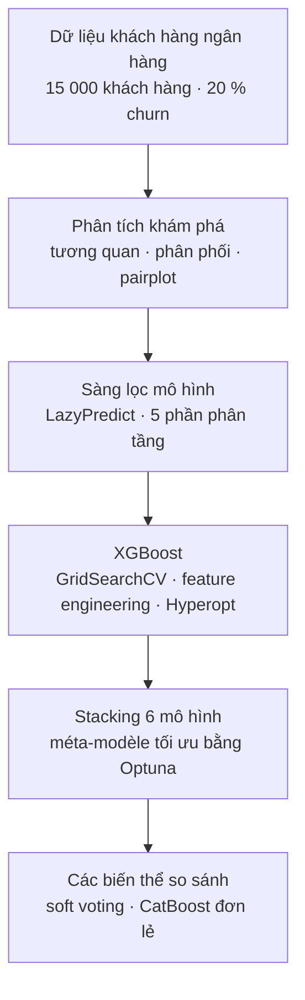

[Français](README.md) · [English](README.en.md) · **Tiếng Việt**

# Dự đoán khách hàng rời bỏ ngân hàng (churn) – cuộc thi Kaggle

Projet Data Mining thuộc chương trình Master 2 MOSEF (Mô hình hoá thống kê kinh tế và tài chính), làm theo nhóm hai người, năm học 2024-2025. Cuộc thi Kaggle của môn học: hạng 1 trên bảng xếp hạng.

Dự đoán xác suất một khách hàng rời bỏ ngân hàng (churn) dựa trên đặc điểm cá nhân và hoạt động tài khoản. Cuộc thi chấm các xác suất nộp lên bằng ROC AUC.

## Kết quả chính

ROC AUC theo kiểm định chéo phân tầng 5 phần (cùng các phần cho mọi mô hình), trên 15 000 khách hàng của tập huấn luyện:

| Mô hình | ROC AUC |
|---|---|
| Hồi quy logistic | 0,891 |
| MLP | 0,929 |
| Random Forest | 0,932 |
| XGBoost | 0,936 |
| LightGBM | 0,936 |
| CatBoost | 0,938 |
| Soft voting 6 mô hình (trọng số tối ưu bằng Optuna) | 0,937 |
| **Stacking 6 mô hình (méta-modèle XGBoost tối ưu bằng Optuna)** | **0,939** |

- Stacking đạt điểm Kaggle cao nhất của nhóm (0,9371), sát với điểm kiểm định chéo.
- CatBoost đơn lẻ có điểm kiểm định gần bằng, nhưng điểm Kaggle giảm rõ rệt nên nhóm chọn stacking.

## Bài toán

Khoảng 20 % khách hàng đã rời ngân hàng. ROC AUC đo khả năng xếp hạng khách hàng theo mức rủi ro, không phụ thuộc ngưỡng quyết định. Các mô hình boosting nhanh chóng chạm trần (≈ 0,936): thách thức là giành thêm vài phần nghìn cuối cùng bằng cách kết hợp mô hình mà không bị overfitting.

## Dữ liệu

Dữ liệu của cuộc thi: `train.csv` (15 000 khách hàng, biến mục tiêu `Exited`, không có giá trị thiếu hay dòng trùng) và `test.csv` (cùng cấu trúc, không có biến mục tiêu).

| Biến | Mô tả |
|---|---|
| `Surname` | Họ của khách hàng |
| `CreditScore` | Điểm tín dụng |
| `Geography` | Quốc gia: Pháp, Đức, Tây Ban Nha |
| `Gender` | Giới tính |
| `Age` | Tuổi |
| `Tenure` | Số năm là khách hàng |
| `Balance` | Số dư tài khoản |
| `NumOfProducts` | Số sản phẩm đang sử dụng |
| `HasCrCard` | Có thẻ tín dụng (0/1) |
| `IsActiveMember` | Khách hàng còn hoạt động (0/1) |
| `EstimatedSalary` | Lương ước tính |
| `Exited` | Biến mục tiêu: 1 = khách hàng đã rời ngân hàng |

Hai mã định danh `id` và `CustomerId` không được dùng làm biến.

## Cách tiếp cận

1. **Phân tích khám phá**: tương quan với biến mục tiêu (`Age` 0,45, `NumOfProducts` −0,31, `IsActiveMember` −0,20), phân phối theo từng lớp, pairplot. Kèm theo một báo cáo profiling (file HTML).
2. **Sàng lọc mô hình** bằng LazyPredict (khoảng ba mươi bộ phân loại): nhóm boosting (LightGBM, AdaBoost, XGBoost) dẫn đầu. Tiền xử lý giữ cho các bước sau: chuẩn hoá, one-hot encoding và target encoding cho `Surname`, fit trong từng phần.
3. **XGBoost**:
   - GridSearchCV trên 108 tổ hợp siêu tham số (ROC AUC 0,937).
   - Thử từng biến trong 14 biến mới; mức cải thiện dưới 0,001, giữ lại 4 biến (`AgeGroup`, `HasNoBalance`, `BalanceToSalaryRatio`, `AverageTenurePerProduct`).
   - Tối ưu Bayes bằng Hyperopt (TPE, 200 lượt thử): không cải thiện đáng kể.
   - Diễn giải bằng SHAP.
4. **Stacking**: 6 mô hình cơ sở (XGBoost, LightGBM, CatBoost, Random Forest, hồi quy logistic, MLP), mỗi nhóm mô hình có tiền xử lý riêng (CatBoost xử lý `Surname` như biến phân loại). Dự đoán out-of-fold của chúng là đầu vào cho méta-modèle: hồi quy logistic (GridSearchCV), sau đó GradientBoosting và XGBoost tối ưu bằng Optuna.
5. **Các biến thể**:
   - Soft voting 6 mô hình, trọng số tối ưu bằng Optuna: kém hơn stacking, khoảng cách train/validation lớn hơn (0,956 so với 0,937).
   - CatBoost đơn lẻ: bỏ sau khi điểm Kaggle giảm.

## Phân tích cho thấy gì

- `NumOfProducts`, `Age` và `IsActiveMember` mang phần lớn tín hiệu (SHAP), khớp với phân tích khám phá.
- Feature engineering và tinh chỉnh siêu tham số gần như không cải thiện thêm so với một XGBoost đã được thiết lập tốt. Mức cải thiện cuối cùng đến từ việc kết hợp các mô hình khác loại.

## Giới hạn

- Chênh lệch giữa các mô hình tốt nhất (0,936 đến 0,939) nhỏ hơn biến động giữa các phần (0,935 đến 0,945 với stacking): thứ hạng giữa chúng chưa chắc chắn.
- Siêu tham số của méta-modèle được chọn và đánh giá trên cùng một lần kiểm định chéo: điểm validation của stacking hơi lạc quan.
- Chưa xác định ngưỡng quyết định: cuộc thi chỉ chấm thứ tự xếp hạng của xác suất. Nếu dùng cho chiến dịch giữ chân khách hàng, cần chọn ngưỡng theo chi phí chiến dịch.
- Target encoding cho `Surname` giúp tăng điểm cuộc thi, nhưng biến này khó chấp nhận trong một mô hình đưa vào vận hành.
- Notebook được viết cho Google Colab. Output đến từ nhiều phiên chạy khác nhau và môi trường chưa được cố định.

## Nhóm thực hiện

Projet làm theo nhóm hai người: Minh Nhat Thy HUYNH, Sara LAVAL-JEANTET.

## Nội dung repo

| File | Nội dung |
|---|---|
| `Sara_Thy_Projet_Data_Mining.ipynb` | Notebook đầy đủ: khám phá dữ liệu, sàng lọc, XGBoost, stacking, voting, CatBoost |
| `Sara - Thy - Projet Data Mining.pdf` | Slide trình bày projet (tháng 12/2024, tiếng Pháp) |
| `Report of dataset - Sara - Thy - Projet Data Mining.html` | Báo cáo profiling tập huấn luyện (ydata-profiling); tải về rồi mở bằng trình duyệt |
| `requirements.txt` | Thư viện và phiên bản của môi trường gốc |

## Chạy notebook

1. Dữ liệu lấy từ cuộc thi Kaggle của môn học (M2 MOSEF); `train.csv` và `test.csv` không có trong repo này.
2. Mở notebook trong Google Colab, rồi tải hai file lên qua hộp thoại upload (`files.upload()`).
3. Các ô ghi « NE PAS LANCER » (không chạy) mất nhiều thời gian (hơn 45 phút, voting tới 1 giờ 30). Kết quả của chúng được giữ trong output.

Môi trường gốc: Google Colab, Python 3.10. Phiên bản thư viện liệt kê trong `requirements.txt`.
